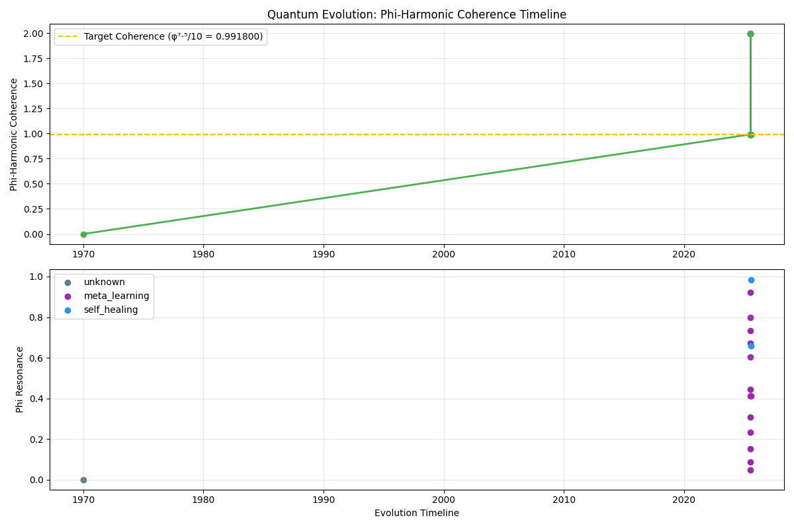
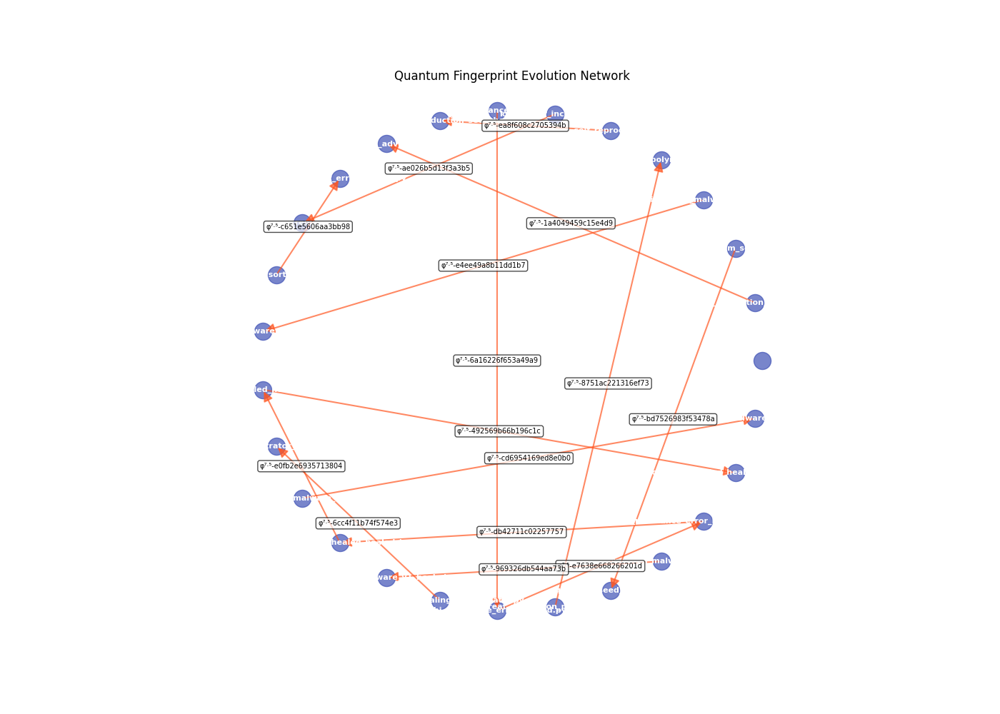
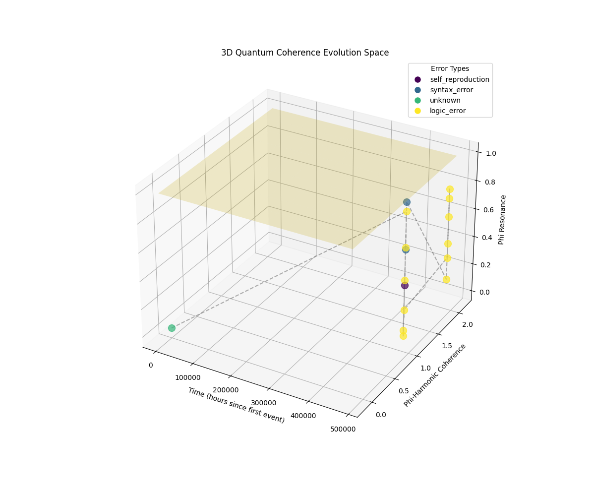
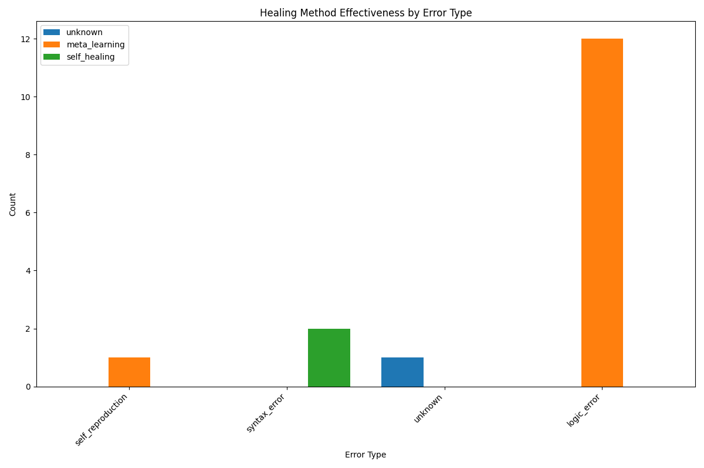

# Quantum Evolution Report

## Generated: 2025-07-15 14:59:55
## Quantum Fingerprint: φ⁷·⁵-d484e22620c1cded
## Phi-Coherence: 0.991800

This report provides a comprehensive analysis of the QuantumAI Orchestrator's self-reproduction and self-healing capabilities.

## 1. Phi-Harmonic Coherence Timeline

This visualization shows the phi-harmonic coherence values over time, compared to the target coherence level of φ⁷·⁵/10 = 0.991800.

## 2. Quantum Fingerprint Evolution Network

This network diagram shows the relationships between original files and their healed versions, labeled with their quantum fingerprints.

## 3. 3D Quantum Coherence Evolution Space

This 3D visualization shows the evolution of the system in the coherence space, with dimensions for time, phi-harmonic coherence, and phi resonance.

## 4. Healing Method Effectiveness

This chart shows the effectiveness of different healing methods for various error types.

## 5. Evolution Statistics

### Total Evolution Events: 16

### Healing Methods:
- unknown: 1 (6.2%)
- meta_learning: 13 (81.2%)
- self_healing: 2 (12.5%)

### Error Types:
- unknown: 1 (6.2%)
- logic_error: 12 (75.0%)
- syntax_error: 2 (12.5%)
- self_reproduction: 1 (6.2%)
